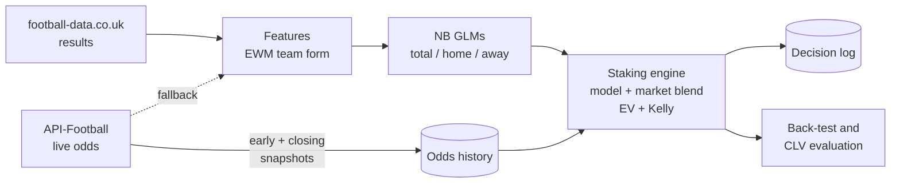

# Football Corners Predictor

A daily data pipeline that forecasts the number of corners in European football matches, compares the forecasts with live bookmaker odds, and tests whether the model finds prices that the market later agrees were wrong.

It covers 10 leagues. Each day it captures odds, ingests results, rebuilds features, retrains when the training data changes, records its staking decisions and grades them. The evaluation is the core of the project: the model is judged by **closing-line value** rather than short-run profit, which at this sample size is mostly noise.

## What this project demonstrates

- **Data engineering:** a scheduled pipeline (GitHub Actions) that ingests from two sources, with incremental loads, an append-only snapshot store, rate-limit and quota handling, automatic fallback between sources, and matching of team names across providers.
- **Statistical modelling:** negative-binomial GLMs for overdispersed counts, time-weighted feature engineering, season-based out-of-sample validation and guards against data leakage.
- **Evaluation:** measuring a betting edge by closing-line value instead of noisy results, with bootstrap confidence intervals.
- **Software engineering:** a typed Python package with a CLI, central configuration, logging, unit and end-to-end tests, linting and continuous integration.
- **Tools:** Python, pandas, NumPy, SciPy, statsmodels, matplotlib, requests, pytest, ruff, GitHub Actions.

---

## Contents

- [How it works](#how-it-works)
- [Modelling](#modelling)
- [Evaluation: closing-line value, not profit](#evaluation-closing-line-value-not-profit)
- [Results](#results)
- [Engineering](#engineering)
- [Project structure](#project-structure)
- [Running it](#running-it)
- [Limitations and next steps](#limitations-and-next-steps)

---

## How it works



`python -m corners run` runs these steps in order:

| Step | Module | What it does |
|---|---|---|
| Capture odds | `corners.data.odds_history` | Records a locked **early** and **closing** price snapshot per fixture for four markets. Runs first because a missed snapshot can never be recovered: the free API plan has no historical odds. |
| Update results | `corners.data.results` | Downloads results from football-data.co.uk, filling recent gaps from API-Football when that source is unavailable. |
| Build features | `corners.features` | Builds exponentially weighted team form (half-life 25 matches) for corners, shots and goals, for and against. |
| Train if needed | `corners.model` | Retrains only when a fingerprint of the training data or model specification changes. |
| Log decisions | `corners.decision_log` | Writes each upcoming fixture's staking decision once, before kickoff, to an append-only log. |
| Back-test and grade | `corners.tracking` | Re-evaluates the odds history with the current model and grades both it and the decision log against results. |
| Evaluate profitability | `corners.evaluation` | Values every bet at the closing price to measure expected return on stake (see below). |

## Modelling

**Distribution.** Corner counts are overdispersed (variance above the mean), so each market is a **negative-binomial GLM** with a log link and league fixed effects. That gives a full probability distribution over the count, from which any over/under line can be priced.

**Three markets, three models.** Features for the home and away models were chosen by forward stepwise selection (AIC, p < 0.05) on training data only.

| Model | Target | Features |
|---|---|---|
| Total corners | home + away corners | corners for/against for both teams, away shots against, market P(over 2.5 goals) |
| Home corners | home corners | home corners for, shots for and goals against; away corners against and shot difference |
| Away corners | away corners | away corners for, goals for and trailing at half time; home corners against, shot difference and goals against |

The models train on every completed season from 2019/20 and are tested on the season in progress, which is never used for training. Each season joins the training data once it finishes. The total-corners model explains little of the variation, which is normal for corner counts because they are dominated by in-match randomness. Modelling each side separately removes the noise that the other side's corners add. Each model's fit (train and test R²) is reported in the training log and saved with the model (see [Results](#results)).

**Combining with the market.** A negative-binomial distribution is also fitted to the bookmaker's whole over/under ladder, giving a market-implied mean. The engine blends the model and market means 50/50, prices every line and side from the blended distribution, and takes the single highest-EV selection per market.

**Staking.** It bets when EV is at least 5%, sized by quarter-Kelly with EV capped at 4% and a ceiling of 10% of bankroll, at odds between 1.0 and 3.0.

## Evaluation: closing-line value, not profit

Short-run profit says little about whether a strategy works. Whether each bet wins is close to a coin flip, so with an edge of a few percent the margin of error on actual return over a few dozen bets is ±30% or more.

Instead, every bet is valued at the **closing price**, the market's final and most accurate estimate of the probability:

> expected profit = stake × (early odds × fair closing probability − 1)

A strategy that keeps getting better prices than the fair closing price makes money in the long run, whatever its results so far. Because this value doesn't depend on whether individual bets win, it gives a reliable answer from far fewer bets.

`python -m corners clv` replays the engine's decisions on the early odds for every fixture with both snapshots, and reports for each market:

- **expected return on stake** at closing prices, with a 95% bootstrap confidence interval, and a verdict: *profitable* (the whole interval is above zero), *losing* (all below zero) or *not clear yet*;
- the share of bets that **beat the fair closing price**;
- the **actual return** on settled bets with its interval, which shows how much wider the uncertainty from results alone is.

## Results

The pipeline publishes its charts to this repository's [`charts` branch](https://github.com/Git4AlexD/football-corners-predictor/tree/charts) after every daily run, so the charts below always show the latest results. The strategy is still being evaluated. The charts contain no odds, fixtures or other provider data, and all stakes are hypothetical, sized from a notional £1,000 bankroll.


Expected return on stake at closing prices (blue) against the actual return so far (orange), each with a 95% confidence interval. A market counts as profitable only when the whole blue interval is above zero. The orange intervals are much wider, which is why results alone can't settle the question yet.


Running profit per market: expected at closing prices against actual. Both charts only include bets with an early and a closing price recorded. Equity curves for each market and a cash-flow chart are on the branch too.

The tables behind the charts are written locally by the pipeline and are not committed:

| File | Contents |
|---|---|
| `results/clv/summary.csv` | Per market: expected and actual return on stake with 95% intervals, and the verdict |
| `results/clv/expected_vs_actual_roi.png` | Chart of expected vs actual return on stake per market |
| `results/clv/profit_over_time.png` | Cumulative expected vs actual profit per market |
| `results/clv/picks.csv` | Every pick, valued at the closing price and settled |
| `results/clv/by_ev_band.csv` | Whether higher calculated EV goes with better prices |
| `results/flat/`, `results/compounding/` | Back-test bets, equity curves and cash flow, with a flat and a compounding bankroll |
| `results/logged_bets.csv` | Decisions as recommended at the time, graded against results |
| `data/model_params.json`, `logs/pipeline.log` | Each model's coefficients, p-values and train/test R², saved whenever it retrains |

## Engineering

- **Retrain only when it matters.** Training uses only completed seasons, so the training set changes when a new season begins, not daily. The pipeline hashes the training rows (in any order) and the model specification, and skips retraining when nothing has changed. A lock file stops two runs overlapping.
- **No leakage into the back-test.** The model stores its training cut-off, and the back-test and CLV evaluation exclude every fixture on or before it. Results therefore stay out-of-sample after each season rollover.
- **What was recommended vs what would be.** The back-test asks how *today's* model would have done. A separate append-only decision log records what the pipeline *actually recommended* before each kickoff, and is graded separately.
- **Consistent team form.** Live predictions and the back-test read the same "form after each team's latest match" table, so a fixture gets identical inputs whether it is predicted before kickoff or re-evaluated afterwards. The test suite checks this equivalence.
- **Odds history as a dataset.** Locking one early and one closing snapshot per fixture builds the dataset that makes the CLV evaluation possible. One unfiltered API request per fixture covers all four markets, a quarter of the per-market cost.
- **Deployment.** The daily run is a scheduled GitHub Actions workflow ([`deploy/daily-pipeline.yml`](deploy/daily-pipeline.yml)) in a separate private repository that stores the data, so the API key, data and run logs never appear in this repository. Each run commits the updated data back and publishes the result charts to this repository's `charts` branch, using a token that can only write to this repository. Only a fixed list of charts is ever published ([`corners/publish.py`](corners/publish.py)).
- **Resilience.** API rate limits are retried with back-off, and part of the daily quota is reserved for odds. Each step falls back to its last good output, so a source outage doesn't stop the run.
- **Name matching across providers.** Token overlap with a similarity tie-break, strict fuzzy matching and an explicit alias table. Unmatched names are logged and surfaced after every run.
- **Quality.** Type hints throughout, `logging` with a rotating log file, settings in one config module, `ruff` linting and formatting, and a `pytest` suite (unit tests plus an end-to-end test on synthetic data) run in GitHub Actions.

## Project structure

```
corners/
├── config.py           # paths and every tunable setting
├── cli.py              # `python -m corners <command>`
├── pipeline.py         # daily run orchestration
├── data/
│   ├── api_football.py # API client: retries, quota tracking, odds parsing
│   ├── odds_history.py # early/closing snapshot store
│   └── results.py      # football-data.co.uk + API fallback
├── features.py         # EWM team form, match and team-form tables
├── model.py            # negative-binomial GLMs, fingerprinted retraining
├── pricing.py          # NB probabilities, de-vigging, market-ladder fit
├── staking.py          # EV and Kelly decisions, fixture evaluation
├── tracking.py         # out-of-sample back-test and grading
├── decision_log.py     # append-only record of live decisions
├── evaluation.py       # profitability measured at closing prices
├── plots.py            # charts
├── publish.py          # the fixed list of charts that are safe to publish
└── teams.py            # cross-provider team-name matching
tests/                  # pytest: unit + end-to-end on synthetic data
deploy/                 # scheduled workflow and git settings for the private data repository
```

Generated files go to `data/`, `results/` and `logs/`, none of which are committed.

## Running it

Requires Python 3.11+ and a free [API-Football](https://www.api-football.com/) key.

```bash
pip install -r requirements.txt
cp .env.example .env               # then add your API key to .env

python -m corners run              # full daily pipeline (also the default with no command)
python -m corners offline          # rebuild everything from local data, no API calls
python -m corners report           # refresh results from stored data without changing it
python -m corners stakes 2026-11-08 2026-11-09   # the model's bets for a date range
python -m corners clv              # profitability evaluation
python -m corners charts out       # copy the shareable charts into the folder `out`
python -m corners --help           # all commands
```

Development:

```bash
pip install -r requirements-dev.txt
pytest
ruff check . && ruff format --check .
```

The first run downloads every season from 2014/15. Odds history accumulates from the day you start running the pipeline.

## Limitations and next steps

- **Sample size.** Historical odds can't be downloaded on the free plan, so the odds history grows one day at a time from the first run, and early evaluations rest on few fixtures.
- **EV calibration.** Calibrating the model's EV against closing-line value, instead of using the raw blend, would give better-sized stakes.
- **Correlated bets.** Total, home and away are evaluated independently, so one fixture can carry up to three correlated bets. This is intentional while comparing markets; a production version would size them jointly.
- **Best-price odds.** Taken across bookmakers. Stake limits and account restrictions at the best-priced bookmaker aren't modelled.

---

*This is a statistics and software project, not betting advice. Gambling involves risk of loss.*
