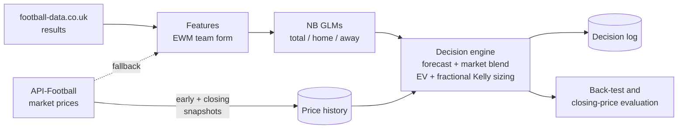
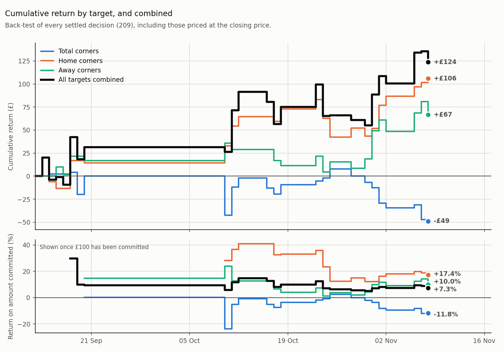

# Probabilistic Forecasting of Football Corner Counts

A data pipeline that produces probabilistic forecasts of the number of corners in European football matches and evaluates them against market prices. Each day it compares the forecast probabilities with the probabilities implied by the over/under prices quoted for each match, and tests, using the market's final (closing) price as the benchmark, whether the forecasts contain information the market had not yet priced in.

Development began in September 2026, and the project moved to GitHub in November 2026.

It covers 10 leagues. Each day it captures market prices, ingests results, rebuilds features, retrains when the training data changes, records its decisions and grades them. The evaluation is the core of the project: forecasts are judged against the closing price rather than against short-run realised outcomes, which at this sample size are mostly noise.

## What this project demonstrates

- **Data engineering:** a scheduled pipeline (GitHub Actions) that ingests from two sources, with incremental loads, an append-only snapshot store, rate-limit and quota handling, automatic fallback between sources, and matching of team names across providers.
- **Probabilistic forecasting:** negative-binomial GLMs that give a full predictive distribution for overdispersed counts, time-weighted feature engineering, season-based out-of-sample validation and guards against data leakage.
- **Evaluation:** assessing forecasts against a market benchmark (closing prices) instead of noisy realised outcomes, with bootstrap confidence intervals.
- **Software engineering:** a typed Python package with a CLI, central configuration, logging, unit and end-to-end tests, linting and continuous integration.
- **Tools:** Python, pandas, NumPy, SciPy, statsmodels, matplotlib, requests, pytest, ruff, GitHub Actions.

---

## Contents

- [How it works](#how-it-works)
- [Modelling](#modelling)
- [Evaluation: against the closing price, not realised outcomes](#evaluation-against-the-closing-price-not-realised-outcomes)
- [Results](#results)
- [Engineering](#engineering)
- [Project structure](#project-structure)
- [Running it](#running-it)
- [Limitations and next steps](#limitations-and-next-steps)

---

## How it works



`python -m corners run` runs these steps in order:

| Step | Module | What it does |
|---|---|---|
| Capture market prices | `corners.data.odds_history` | Records a locked **early** and **closing** price snapshot per fixture for four price types. Runs first because a missed snapshot can never be recovered: the free API plan has no historical prices. |
| Update results | `corners.data.results` | Downloads results from football-data.co.uk, filling recent gaps from API-Football when that source is unavailable. |
| Build features | `corners.features` | Builds exponentially weighted team form (half-life 25 matches) for corners, shots and goals, for and against. |
| Train if needed | `corners.model` | Retrains only when a fingerprint of the training data or model specification changes. |
| Log decisions | `corners.decision_log` | Writes each upcoming fixture's decision once, before kickoff, to an append-only log. |
| Back-test and grade | `corners.tracking` | Re-evaluates the price history with the current model and grades both it and the decision log against results. |
| Evaluate against closing prices | `corners.evaluation` | Values every decision at the closing price to measure its expected return (see below). |

## Modelling

**Distribution.** Corner counts are overdispersed (variance above the mean), so each target is modelled with a **negative-binomial GLM** with a log link and league fixed effects. That gives a full probability distribution over the count, from which the probability of any over/under line can be calculated.

**Three targets, three models.** Features for the home and away models were chosen by forward stepwise selection (AIC, p < 0.05) on training data only.

| Model | Target | Features |
|---|---|---|
| Total corners | home + away corners | corners for/against for both teams, away shots against, market P(over 2.5 goals) |
| Home corners | home corners | home corners for, shots for and goals against; away corners against and shot difference |
| Away corners | away corners | away corners for, goals for and trailing at half time; home corners against, shot difference and goals against |

The models train on every completed season from 2019/20 and are tested on the season in progress, which is never used for training. Each season joins the training data once it finishes. The total-corners model explains little of the variation, which is normal for corner counts because they are dominated by in-match randomness. Modelling each side separately removes the noise that the other side's corners add. Each model's fit (train and test R²) is reported in the training log and saved with the model (see [Results](#results)).

**Combining with the market.** A negative-binomial distribution is also fitted to the whole ladder of over/under prices quoted for a fixture, giving a market-implied mean. The engine blends the model and market means 50/50, calculates the probability of every line and side from the blended distribution, and takes the single highest-EV selection per target.

**Position sizing.** A selection is taken when its expected value (EV) is at least 5%. It is sized by quarter-Kelly, with EV capped at 4% and a ceiling of 10% of capital, for decimal prices between 1.0 and 3.0.

## Evaluation: against the closing price, not realised outcomes

Realised outcomes say little about forecast quality over a short period. Whether each outcome lands above or below its line is close to a coin flip, so with an advantage of a few percent the margin of error on the realised return over a few dozen decisions is ±30% or more.

Instead, every decision is valued at the **closing price**, the market's final and most accurate estimate of the probability:

> expected return = position size × (early price × fair closing probability − 1)

A forecast that consistently finds better prices than the fair closing price has real information in it, whatever its realised results so far. Because this value doesn't depend on individual outcomes, it gives a reliable answer from far fewer decisions.

`python -m corners clv` replays the engine's decisions on the early prices for every fixture with both snapshots, and reports for each target:

- the **expected return** at closing prices, with a 95% bootstrap confidence interval, and a verdict: whether the whole interval is above zero, all below zero, or *not clear yet*;
- the share of decisions that **beat the fair closing price**;
- the **realised return** on settled decisions with its interval, which shows how much wider the uncertainty from outcomes alone is.

## Results

The pipeline publishes its charts to this repository's [`charts` branch](https://github.com/Git4AlexD/football-corners-predictor/tree/charts) after every daily run, so the charts below always show the latest results. The evaluation is still in progress. The charts contain no prices, fixtures or other provider data, and all positions are hypothetical, sized from a notional £1,000 of capital.


Expected return at closing prices (blue) against the realised return so far (orange), each with a 95% confidence interval. A target shows a real advantage only when the whole blue interval is above zero. The orange intervals are much wider, which is why realised outcomes alone can't settle the question yet.


Running return per target: expected at closing prices against realised. Both charts above only include decisions with an early and a closing price recorded.



Cumulative return for each target and for all three combined (top), with the return on the amount committed underneath. This chart is built from a different set of data, so its values differ from the two above: it is a back-test of every settled decision, including those priced at the closing price because no early price was recorded, which was the case for some price types at the start. The charts above keep only decisions with both prices, because that is what the closing-price evaluation needs. Charts per target and a cash-flow chart are on the branch too.

The tables behind the charts are written locally by the pipeline and are not committed:

| File | Contents |
|---|---|
| `results/clv/summary.csv` | Per target: expected and realised return with 95% intervals, and the verdict |
| `results/clv/expected_vs_actual_roi.png` | Chart of expected vs realised return per target |
| `results/clv/profit_over_time.png` | Cumulative expected vs realised return per target |
| `results/clv/picks.csv` | Every selection, valued at the closing price and settled |
| `results/clv/by_ev_band.csv` | Whether a higher calculated EV goes with better prices |
| `results/flat/`, `results/compounding/` | Back-test decisions, charts and cash flow, with fixed and compounding capital |
| `results/logged_bets.csv` | Decisions as recommended at the time, graded against results |
| `data/model_params.json`, `logs/pipeline.log` | Each model's coefficients, p-values and train/test R², saved whenever it retrains |

## Engineering

- **Retrain only when it matters.** Training uses only completed seasons, so the training set changes when a new season begins, not daily. The pipeline hashes the training rows (in any order) and the model specification, and skips retraining when nothing has changed. A lock file stops two runs overlapping.
- **No leakage into the back-test.** The model stores its training cut-off, and the back-test and closing-price evaluation exclude every fixture on or before it. Results therefore stay out-of-sample after each season rollover.
- **What was recommended vs what would be.** The back-test asks how *today's* model would have done. A separate append-only decision log records what the pipeline *actually recommended* before each kickoff, and is graded separately.
- **Consistent team form.** Live predictions and the back-test read the same "form after each team's latest match" table, so a fixture gets identical inputs whether it is predicted before kickoff or re-evaluated afterwards. The test suite checks this equivalence.
- **Price history as a dataset.** Locking one early and one closing price snapshot per fixture builds the dataset that makes the closing-price evaluation possible. One unfiltered API request per fixture covers all four price types, a quarter of the per-type cost.
- **Deployment.** The daily run is a scheduled GitHub Actions workflow ([`deploy/daily-pipeline.yml`](deploy/daily-pipeline.yml)) in a separate private repository that stores the data, so the API key, data and run logs never appear in this repository. Each run commits the updated data back and publishes the result charts to this repository's `charts` branch, using a token that can only write to this repository. Only a fixed list of charts is ever published ([`corners/publish.py`](corners/publish.py)).
- **Resilience.** API rate limits are retried with back-off, and part of the daily quota is reserved for price capture. Each step falls back to its last good output, so a source outage doesn't stop the run.
- **Name matching across providers.** Token overlap with a similarity tie-break, strict fuzzy matching and an explicit alias table. Unmatched names are logged and surfaced after every run.
- **Quality.** Type hints throughout, `logging` with a rotating log file, settings in one config module, `ruff` linting and formatting, and a `pytest` suite (unit tests plus an end-to-end test on synthetic data) run in GitHub Actions.

## Project structure

```
corners/
├── config.py           # paths and every tunable setting
├── cli.py              # `python -m corners <command>`
├── pipeline.py         # daily run orchestration
├── data/
│   ├── api_football.py # API client: retries, quota tracking, price parsing
│   ├── odds_history.py # early/closing price snapshot store
│   └── results.py      # football-data.co.uk + API fallback
├── features.py         # EWM team form, match and team-form tables
├── model.py            # negative-binomial GLMs, fingerprinted retraining
├── pricing.py          # NB probabilities, removing the market margin, market-ladder fit
├── staking.py          # EV and position-sizing decisions, fixture evaluation
├── tracking.py         # out-of-sample back-test and grading
├── decision_log.py     # append-only record of live decisions
├── evaluation.py       # evaluation against closing prices
├── plots.py            # charts
├── publish.py          # the fixed list of charts that are safe to publish
└── teams.py            # cross-provider team-name matching
tests/                  # pytest: unit + end-to-end on synthetic data
deploy/                 # scheduled workflow and git settings for the private data repository
```

Generated files go to `data/`, `results/` and `logs/`, none of which are committed.

## Running it

Requires Python 3.11+ and a free [API-Football](https://www.api-football.com/) key.

```bash
pip install -r requirements.txt
cp .env.example .env               # then add your API key to .env

python -m corners run              # full daily pipeline (also the default with no command)
python -m corners offline          # rebuild everything from local data, no API calls
python -m corners report           # refresh results from stored data without changing it
python -m corners stakes 2026-11-08 2026-11-09   # the model's decisions for a date range
python -m corners clv              # evaluation against closing prices
python -m corners charts out       # copy the shareable charts into the folder `out`
python -m corners --help           # all commands
```

Development:

```bash
pip install -r requirements-dev.txt
pytest
ruff check . && ruff format --check .
```

The first run downloads every season from 2014/15. Price history accumulates from the day you start running the pipeline.

## Limitations and next steps

- **Sample size.** Historical prices can't be downloaded on the free plan, so the price history grows one day at a time from the first run, and early evaluations rest on few fixtures.
- **EV calibration.** Calibrating the model's EV against the closing price, instead of using the raw blend, would give better-sized positions.
- **Correlated selections.** Total, home and away are evaluated independently, so one fixture can carry up to three correlated selections. This is intentional while comparing the targets; a production version would size them jointly.
- **Best available prices.** Taken across providers. Transaction limits and access restrictions at the best-priced provider aren't modelled.

---

*This is a statistics and software project, not financial advice. All positions are hypothetical.*
